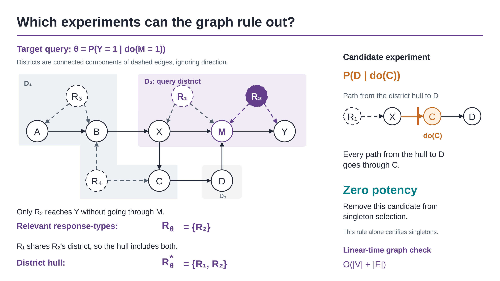

# Optimal Experiments for Partial Causal Effect Identification

**NeurIPS 2026** · Tobias Maringgele, Jalal Etesami · Technical University of Munich

[Read the paper on arXiv](https://arxiv.org/abs/2605.06993)



Observational data usually doesn't identify a causal effect, it only bounds it.
Experiments tighten those bounds, but they cost money, so you have to decide
which ones to run before seeing any of their outcomes. We formalize that
decision as the *max-potency problem*: find a set of
experiments with the largest guaranteed reduction in bound width, while staying in-budget.
The problem is NP-hard, but two graphical criteria can certify an experiment as
worthless from the causal graph alone, which prunes 50–88% of the candidates
before any optimization runs. The last section works on NHANES data, choosing
experiments for the effect of physical activity on diabetes.

Everything behind the experiments and tables is in `code/`. Start at
[`code/README.md`](code/README.md): it says which notebook produces which
result, what you need installed (autobound and couenne can be a bit awkward),
and roughly how long each thing takes.

## Citing

```bibtex
@inproceedings{maringgele2026optimal,
  title     = {Optimal Experiments for Partial Causal Effect Identification},
  author    = {Maringgele, Tobias and Etesami, Jalal},
  booktitle = {Advances in Neural Information Processing Systems},
  year      = {2026},
  url       = {https://arxiv.org/abs/2605.06993}
}
```

## License

MIT, see [`LICENSE`](LICENSE). Third-party code included here keeps its own
license; those are in [`code/LICENSES/`](code/LICENSES).
